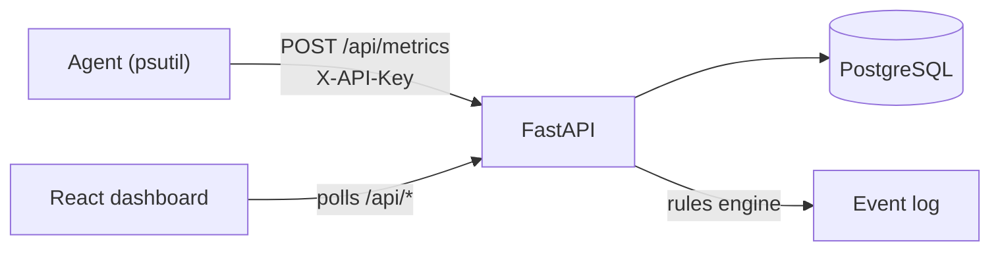

# PulseOps — System Monitoring & Operations Platform

A full-stack monitoring platform. A Python **agent** reads real CPU, RAM, disk and uptime
figures from a machine (via `psutil`) and reports them to a **FastAPI** backend. Metrics are
stored in **PostgreSQL** and shown in a **React + TypeScript** dashboard with historical
charts, configurable alert rules and an event log.



## Features

- Real metrics: CPU %, memory, disk, uptime (no mock data)
- Historical charts (15 min → 7 days), averaged server-side into ≤120 points
- Alert rules: metric above/below a threshold, per host or all hosts, three severities, on/off switch
- Event log: an alert is logged once when a rule starts breaching and once when it resolves
- Host status: a host that goes silent for 30s is logged as offline, and as back online when it returns
- Agent authentication via a shared API key; old metrics purged after 7 days
- Pydantic validation on every request; 15 automated backend tests

## Project layout

```
agent/      collector.py (reads metrics) + agent.py (sends them)
backend/    FastAPI app: models, schemas, routers, services, tests
frontend/   Vite + React + TypeScript dashboard
docker-compose.yml   PostgreSQL + backend + frontend
```

## Run it locally (Windows / PowerShell)

You need Python 3.11+, Node 18+ and Docker Desktop. Use **three terminals**.

**1. Database + backend** (from the project root)

```powershell
docker compose up -d db                       # PostgreSQL on localhost:5432
cd backend
python -m venv .venv
.\.venv\Scripts\Activate.ps1
pip install -r requirements-dev.txt
Copy-Item .env.example .env
uvicorn app.main:app --reload
```

API docs: http://127.0.0.1:8000/docs (tables are created automatically on first start).

**2. Agent** (monitors the machine it runs on)

```powershell
cd agent
python -m venv .venv
.\.venv\Scripts\Activate.ps1
pip install -r requirements.txt
python agent.py
```

**3. Dashboard**

```powershell
cd frontend
npm install
npm run dev
```

Open http://localhost:5173. Data appears a few seconds after the agent starts.

## Tests

```powershell
cd backend
.\.venv\Scripts\Activate.ps1
pytest
```

Tests use an in-memory SQLite database, so they need no running services.

## Deploy with Docker Compose

```powershell
Copy-Item .env.example .env      # then edit API_KEY and POSTGRES_PASSWORD
docker compose up --build -d
```

Dashboard: http://localhost:3000 · API: http://localhost:8000.
The agent is **not** containerised on purpose: inside Docker it would measure the container,
not your machine. Run it on each host you want to monitor, pointing at the API:

```powershell
python agent.py --url http://<server>:8000 --key <your API_KEY> --interval 5
```

## API summary

| Method | Path | Purpose |
|---|---|---|
| POST | `/api/metrics` | Agent submits a report (needs `X-API-Key`) |
| GET | `/api/metrics/latest?hostname=` | Most recent report |
| GET | `/api/metrics/history?hostname=&minutes=` | Chart data |
| GET | `/api/hosts` | Known hosts + online status |
| GET/POST | `/api/alert-rules` | List / create rules |
| PATCH/DELETE | `/api/alert-rules/{id}` | Edit (e.g. enable/disable) / delete |
| GET | `/api/events` | Event log (filter by `severity`, `hostname`) |
| GET | `/api/events/summary` | Alert counts by severity |

## Design decisions

- **Agent pushes, backend stores.** Hosts only need outbound HTTP, and the backend never needs credentials for them.
- **State from the log.** Whether a rule is "firing" is derived from its last event, so there is no separate state table to drift out of sync.
- **Polling, not WebSockets.** At a 5s interval, polling is simple and robust; WebSockets would be the next step.
- **`create_all` instead of migrations.** Fine for this scope; Alembic is the upgrade path once the schema changes.

## Ideas for next steps

Authentication for the dashboard, email/Slack notifications, per-process metrics, network I/O, TimescaleDB for long retention.
